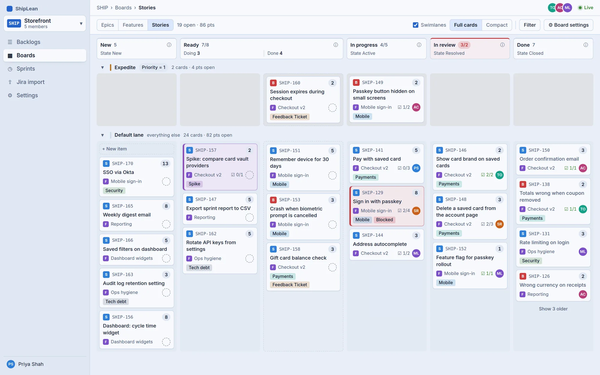

  <picture>
    <source media="(prefers-color-scheme: dark)" srcset="shiplean-logo-on-dark.svg">
    
  </picture>

<h3 align="center">AI-native project management, built for humans and agents.</h3>

  <a href="https://shiplean.app">shiplean.app</a> ·
  <a href="https://github.com/ShipLean/ShipLean">ShipLean</a> ·
  <a href="https://github.com/ShipLean/docs">Docs</a>

ShipLean is a free, open-source planning tool you host yourself. Rank a backlog, run a Kanban board, plan sprints or mix them, and see which sprint each backlog item is likely to land in. Connect Claude Code, Cursor or Claude Desktop over MCP and your agents can plan, pick up and report work on the same backlog, with their name on every change they make.

<picture>
  <source media="(prefers-color-scheme: dark)" srcset="board-dark.webp">
  
</picture>

### What's in it

- **Kanban or Scrum, your way.** A ranked backlog, Kanban boards, sprints and a sprint taskboard. Name your own states, set up columns and WIP limits.
- **Forecasts and reports.** See which sprint each backlog item is likely to land in. Burndown, velocity and history come from every change, so the numbers add up.
- **Live for the whole team.** Changes show up for everyone as they happen, and you can see who else is on the same screen.
- **Agents on the same backlog.** An MCP server lets agents read and update the same backlog, boards and sprints as the team. You approve each agent in the browser and can revoke it at any time.
- **AI search.** Press ⌘P on any screen. Semantic search matches meaning as well as exact words, for people and agents alike.
- **Jira import.** Bring a Jira project across with its history, comments and sprints. Your Jira stays exactly as it was.

### Status

ShipLean is not released yet. Watch [ShipLean/ShipLean](https://github.com/ShipLean/ShipLean) to hear when it is ready to install.
